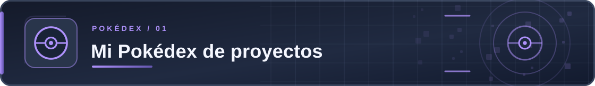
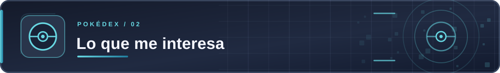
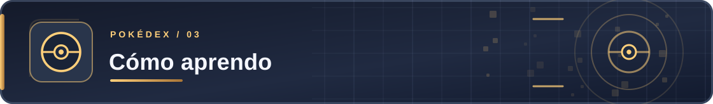
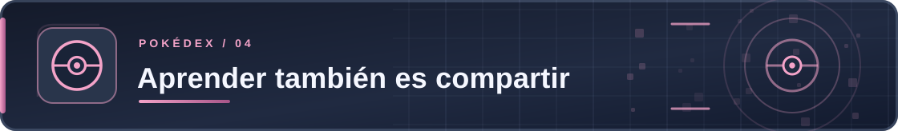
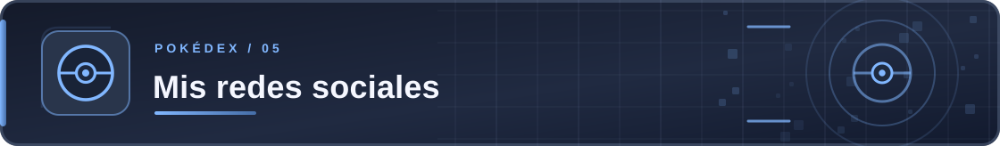
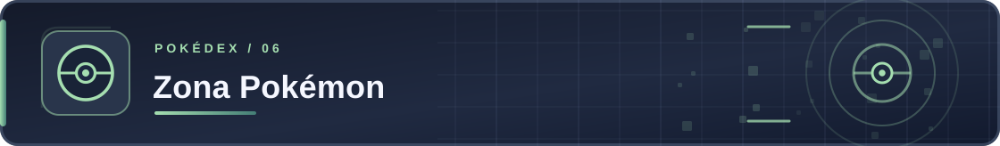

<!-- README para un perfil de GitHub. Los Pokémon se muestran como GIF animados. -->

    <h1>Legalmenteadriangalindez</h1>  
<b>Aprendo construyendo. Comparto lo que descubro.</b>
  
Me gusta convertir ideas en proyectos: desde aplicaciones web hasta experimentos con inteligencia artificial. Este perfil es mi Pokédex de código, pruebas y cosas que sigo aprendiendo.
  

    
    
    
  
  

    <a href="#proyectos">Proyectos</a> ·
    <a href="#intereses">Lo que me interesa</a> ·
    <a href="#aprendizaje">Cómo aprendo</a> ·
    <a href="#comunidad">Comunidad</a> ·
    <a href="#redes-sociales">Redes sociales</a> ·
    <a href="#zona-pokemon">Zona Pokémon</a>
  

  

Mi Pokédex de proyectos
No todos mis proyectos están terminados, y eso también es parte del proceso. Estos son algunos de los que he construido o utilizado para experimentar. Cada uno tiene un Pokémon que representa su idea.
<table>
  <tr>
    <td width="50%" valign="top" align="center">
      
      <h3>ERP</h3>
      
MEGA METAGROSS · INGENIERÍA

      
Exploro cómo organizar las piezas de un sistema de gestión empresarial.

      
<a href="https://github.com/Legalmenteadriangalindez/ERP"><b>Explorar código</b></a>

    </td>
    <td width="50%" valign="top" align="center">
      
      <h3>Pre-ICFES con chatbot</h3>
      
MEGA ALAKAZAM · EDUCACIÓN + IA

      
Un sistema para trabajar con habilidades académicas, evaluaciones y apoyo conversacional.

      
<a href="https://github.com/Legalmenteadriangalindez/Sistema-pre-ICFES-de-prediccion-de-habilidades-y-debilidades-academicas-con-Chatbot"><b>Explorar código</b></a>

    </td>
  </tr>
  <tr>
    <td valign="top" align="center">
      
      <h3>Tienda Galíndez</h3>
      
MEOWTH · E-COMMERCE

      
Mi tienda en línea: un proyecto para llevar el desarrollo web a un caso real.

      
<a href="https://github.com/Legalmenteadriangalindez/E-Commerce-Tienda-Galindez"><b>Código</b></a> · <a href="https://e-commerce-tienda-galindez.onrender.com/"><b>Ver tienda</b></a>

    </td>
    <td valign="top" align="center">
      
      <h3>Machine Learning</h3>
      
PORYGON-Z · DATOS + MODELOS

      
Cuadernos, modelos y pruebas para entender qué funciona y por qué.

      
<a href="https://github.com/Legalmenteadriangalindez/MachineLearning"><b>Explorar código</b></a>

    </td>
  </tr>
  <tr>
    <td valign="top" align="center">
      
      <h3>Label Studio</h3>
      
SMEARGLE · ANOTACIÓN DE DATOS

      
Pruebas y herramientas relacionadas con el etiquetado de información.

      
<a href="https://github.com/Legalmenteadriangalindez/LabelStudio"><b>Explorar código</b></a> · <a href="https://labelstudio-p7tc.onrender.com"><b>ingresar a Label Studio</b></a>

    </td>
    <td valign="top" align="center">
      
      <h3>LabelStudio Media</h3>
      
DITTO · RECURSOS DE PRUEBA

      
Archivos de apoyo para probar y adaptar flujos de anotación.

      
<a href="https://github.com/Legalmenteadriangalindez/labelstudio-media"><b>Explorar archivos</b></a>

    </td>
  </tr>
  <tr>
  <td valign="top" align="center">
  
  <h3>Ebook Traductions Read</h3>
  
CHATOT · Traducción y lectura de PDF

  
Traduce documentos PDF, conserva su formato
     y permite escucharlos mediante lectura en voz alta.

  
<a href="https://github.com/Legalmenteadriangalindez/labelstudio-media"><b>Explorar archivos</b></a>· <a href="https://ebook-traductions-read.onrender.com"><b>ingresar a Ebook Traductions Read</b></a>

</td>
  <td valign="top" align="center">
  
  <h3>LupaAI</h3>
  
CHATOT · Traducción y lectura de PDF

  
Traduce documentos PDF, conserva su formato
     y permite escucharlos mediante lectura en voz alta.

  
<a href="https://github.com/legalmenteadriangalindez/LupaIA"><b>Explorar archivos</b></a>· <a href="#"><b>ingresar a LupaAI</b></a>

</td>
  </tr>

  <tr>
<td valign="top" align="center">
  
  <h3>Videojuegos</h3>
  
INTELEON · SHOOTERS FPS / TPS

  
Desarrollo de videojuegos de disparos en primera
     y tercera persona, con mecánicas de combate,
     precisión y acción.

  
<a href="https://github.com/Legalmenteadriangalindez/labelstudio-media"><b>Explorar archivos</b></a> · <a href="https://legalmenteadriangalindez.itch.io"><b>Ingresar a Itch.io</b></a>

</td>
<td valign="top" align="center">
  
  <h3>Investigaciones</h3>
  
UXIE · INVESTIGACIÓN Y CONOCIMIENTO

  
Exploro investigaciones en inteligencia artificial,
     ciencia de datos, ingeniería de software y nuevas
     tecnologías, compartiendo hallazgos y aprendizajes.

  
<a href="https://github.com/legalmenteadriangalindez?tab=repositories"><b>Explorar investigaciones</b></a> · <a href="#"><b>Ver publicaciones</b></a>

</td>

  </tr>

<!-- PRÓXIMOS PROYECTOS -->
<tr>
  <td colspan="2" align="center">
    <h3>🚀 Próximos proyectos</h3>
    
IDEAS EN PLANIFICACIÓN · PRÓXIMAMENTE

    
Arquitecturas y tecnologías que quiero explorar
       mediante proyectos funcionales.

  </td>
</tr>
<tr>
  <td width="50%" valign="top" align="center">
    
    <h3>SaaS Multi-Tenant</h3>
    
ZYGARDE · MICRO-FRONTENDS + EDGE

    
Plataforma SaaS con múltiples tiendas,
       módulos independientes, arquitectura
       distribuida y aislamiento de datos.

    
🚧 PRÓXIMAMENTE

    
<a href="#"><b>Explorar código</b></a> · <a href="#"><b>Ver demo</b></a>

  </td>
  <td width="50%" valign="top" align="center">
    
    <h3>WebAssembly Lab</h3>
    
GENESECT · RUST + WASM

    
Aplicación web de procesamiento de imágenes
       y cálculos de alto rendimiento, comparando
       la ejecución de Rust WebAssembly y JavaScript.

    
🚧 PRÓXIMAMENTE

    
<a href="#"><b>Explorar código</b></a> · <a href="#"><b>Ver demo</b></a>

  </td>
</tr>
<tr>
  <td width="50%" valign="top" align="center">
    
    <h3>Agentes IA + RAG</h3>
    
MAGEARNA · IA GENERATIVA + AUTOMATIZACIÓN

    
Plataforma inteligente para consultar
       documentos mediante búsqueda vectorial
       y ejecutar tareas con agentes de IA.

    
🚧 PRÓXIMAMENTE

    
<a href="#"><b>Explorar código</b></a> · <a href="#"><b>Ver demo</b></a>

  </td>
  <td width="50%" valign="top" align="center">
    
    <h3>Real-Time Analytics</h3>
    
JOLTEON · EVENTOS + STREAMING

    
Dashboard de monitoreo en tiempo real
       con eventos simulados, mensajería,
       WebSockets y gráficas dinámicas.

    
🚧 PRÓXIMAMENTE

    
<a href="#"><b>Explorar código</b></a> · <a href="#"><b>Ver demo</b></a>

  </td>
</tr>
<tr>
  <td width="50%" valign="top" align="center">
    
    <h3>Device Financing Lock</h3>
    
KLEFKI · SEGURIDAD + FINANCIACIÓN

    
Prototipo de gestión de dispositivos financiados,
       con seguimiento de pagos y simulación de bloqueo
       y desbloqueo autorizados.

    
🚧 PRÓXIMAMENTE · ACCESO PRIVADO

    

      
<b>🔒 Solicitar información o colaboración</b>

      
Este proyecto está planificado con código fuente privado y no estará disponible públicamente.

      
Si deseas conocer más, proponer una colaboración o solicitar acceso, puedes escribirme por correo.

      

    

  </td>
  <td width="50%" valign="top" align="center">
    
    <h3>AuditQuest: Inside the System</h3>
    
LUXRAY · VIDEOJUEGO + AUDITORÍA DE SISTEMAS

    
Videojuego educativo para explorar sistemas,
       identificar riesgos, revisar controles y resolver
       misiones de auditoría mediante desafíos interactivos.

    
🚧 PRÓXIMAMENTE

    
<a href="#"><b>Explorar código</b></a> · <a href="#"><b>Ver demo</b></a>

  </td>
</tr>
</table>

  
<b>¿Por qué estos Pokémon?</b>

  Mega Metagross representa sistemas complejos que trabajan como uno solo; Mega Alakazam, análisis e inteligencia; Meowth, comercio por su clásico Día de Pago; Porygon-Z, el mundo digital; Smeargle, el trabajo de marcar y etiquetar; y Ditto, la versatilidad de los datos de prueba.

  

Lo que me interesa
No me gusta quedarme en una sola tecnología. Prefiero unir lo que aprendo y ver si una idea puede convertirse en algo útil.
<table>
  <tr>
    <td width="33%" align="center" valign="top">
      
      <h3>Construir</h3>
      
Programación, arquitectura, aplicaciones web y buenas prácticas.

    </td>
    <td width="33%" align="center" valign="top">
      
      <h3>Investigar</h3>
      
Inteligencia artificial, datos, automatización y seguridad.

    </td>
    <td width="33%" align="center" valign="top">
      
      <h3>Experimentar</h3>
      
Videojuegos, prototipos, productos digitales e ideas nuevas.

    </td>
  </tr>

</table>

  
<b>Ver mis compañeros por área</b>
Área	Pokémon	En qué me enfoco
Ingeniería		Arquitectura, calidad y pruebas
Programación		Lógica y desarrollo de software
IA y datos		Modelos, análisis y automatización
Seguridad		Privacidad y seguridad informática
Web		Frontend, backend y experiencia de usuario
Videojuegos		Mecánicas y prototipado
Emprendimiento		Productos y soluciones reales
Creatividad		Diseño y experimentación

  

Cómo aprendo

  
  &nbsp;&nbsp;
    
<b>Magikarp hoy, Gyarados mañana.</b>

La mayoría de las cosas las entiendo cuando intento hacerlas: programo, me equivoco, reviso qué pasó y vuelvo a probar. No quiero un perfil que solo enseñe proyectos perfectos; también quiero que muestre lo que fui descubriendo por el camino.

Me gusta trabajar con problemas reales, escribir código que pueda entender después y compartir soluciones que puedan servirle a alguien más.

  

Aprender también es compartir

  
  

Me gusta encontrar personas curiosas, intercambiar ideas y aprender de quienes ven los problemas de otra manera. Da igual si alguien está empezando o lleva años programando: siempre hay algo que podemos enseñarnos.

Mi regla favorita: compartir lo que sabes sin hacer sentir menos a quien todavía está aprendiendo.

  
<b>Pequeñas reglas para una buena comunidad</b>
- Respetar a las personas, incluso cuando pensamos diferente.
- Preguntar sin pena y responder sin burlas.
- Dar comentarios útiles, no ataques personales.
- Reconocer el trabajo de los demás.
- Aprender juntos y también pasarla bien.

  

Mis redes sociales
También comparto parte de lo que aprendo fuera de GitHub. Aquí puedes encontrar mis videos, proyectos y experiencias mientras sigo explorando nuevas ideas.

## Mis redes sociales

También comparto lo que aprendo y construyo fuera de GitHub.

<table>
  <tr>
    <td width="50%" valign="top" align="center">
      
      <h3>YouTube</h3>
      
MELOETTA · VIDEOS Y APRENDIZAJE

      
Comparto proyectos, experimentos y lo que voy aprendiendo sobre tecnología.

      
<a href="https://www.youtube.com/@legalmenteadriangalindez"><b>Visitar mi canal</b></a>

    </td>
    <td width="50%" valign="top" align="center">
      
      <h3>Facebook</h3>
      
PACHIRISU · COMUNIDAD Y CONEXIONES

      
Un espacio para conectar, compartir ideas y aprender con otras personas.

      
<a href="#"><b>Visitar Facebook</b></a>

    </td>
  </tr>
  <tr>
    <td width="50%" valign="top" align="center">
      
      <h3>Instagram</h3>
      
VIVILLON · CREATIVIDAD Y PROYECTOS

      
Ideas, diseños y momentos del proceso de crear y experimentar.

      
<a href="#"><b>Visitar Instagram</b></a>

    </td>
    <td width="50%" valign="top" align="center">
      
      <h3>TikTok</h3>
      
LUDICOLO · CREATIVIDAD Y ENTRETENIMIENTO

      
Contenido corto, curiosidades y experiencias sobre tecnología y aprendizaje.

      
<a href="#"><b>Visitar TikTok</b></a>

    </td>
  </tr>

</table>

  

Zona Pokémon
Un pequeño rincón para dejar lo técnico a un lado. Aquí están los otros Pokémon que me gustan para representar ideas, emociones y etapas del aprendizaje.

  
<b>Elige tu Pokémon inicial</b>
  <table>
    <tr>
      <td width="33%" align="center" valign="top">
        
        
<b>Charmander</b>

        
La energía para empezar.

      </td>
      <td width="33%" align="center" valign="top">
        
        
<b>Squirtle</b>

        
Avanzar con paciencia.

      </td>
      <td width="33%" align="center" valign="top">
        
        
<b>Bulbasaur</b>

        
Crecer con curiosidad.

      </td>
    </tr>
  </table>

  
<b>Mi Pokédex de emociones</b>

  <table>
    <thead>
      <tr>
        <th align="center">Momento</th>
        <th align="center">Pokémon</th>
        <th align="center">Lo que me recuerda</th>
      </tr>
    </thead>
    <tbody>
      <tr>
        <td align="center">Empezar una idea</td>
        <td align="center"></td>
        <td align="center">Dar el primer paso</td>
      </tr>
      <tr>
        <td align="center">Aprender algo nuevo</td>
        <td align="center"></td>
        <td align="center">Explorar diferentes caminos</td>
      </tr>
      <tr>
        <td align="center">Resolver un error</td>
        <td align="center"></td>
        <td align="center">Reírme un poco del bug</td>
      </tr>
      <tr>
        <td align="center">Tener paciencia</td>
        <td align="center"></td>
        <td align="center">No todo tiene que salir de inmediato</td>
      </tr>
      <tr>
        <td align="center">No rendirme</td>
        <td align="center"></td>
        <td align="center">La práctica cambia las cosas</td>
      </tr>
      <tr>
        <td align="center">Cuidar al equipo</td>
        <td align="center"></td>
        <td align="center">Empatía y compañerismo</td>
      </tr>
      <tr>
        <td align="center">Encontrar una solución</td>
        <td align="center"></td>
        <td align="center">Celebrar las pequeñas victorias</td>
      </tr>
      <tr>
        <td align="center">Descansar</td>
        <td align="center"></td>
        <td align="center">Tomar distancia también ayuda</td>
      </tr>
      <tr>
        <td align="center">Divertirme programando</td>
        <td align="center"></td>
        <td align="center">El humor hace parte del camino</td>
      </tr>
      <tr>
        <td align="center">Mirar hacia adelante</td>
        <td align="center"></td>
        <td align="center">Curiosidad por el futuro</td>
      </tr>
    </tbody>
  </table>

  
<b>Mi equipo de valores</b>

  <table>
    <thead>
      <tr>
        <th align="center">Valor</th>
        <th align="center">Pokémon</th>
      </tr>
    </thead>
    <tbody>
      <tr>
        <td align="center">Propósito</td>
        <td align="center"></td>
      </tr>
      <tr>
        <td align="center">Ambición con los pies en la tierra</td>
        <td align="center"></td>
      </tr>
      <tr>
        <td align="center">Disciplina</td>
        <td align="center"></td>
      </tr>
      <tr>
        <td align="center">Conexión y colaboración</td>
        <td align="center"> </td>
      </tr>
    </tbody>
  </table>

  
  
Gracias por pasar por mi Pokédex. Nos vemos en el próximo proyecto.

